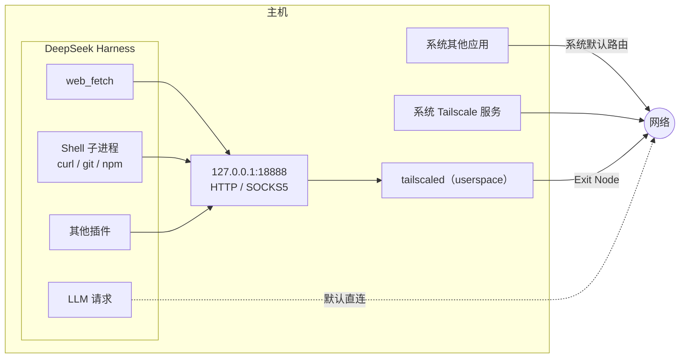

<div align="center">


# Tailtransit

**为 DeepSeek Harness 提供基于 Tailscale 出口节点的独立网络出口，不改变系统网络配置。**

[](LICENSE)
[](https://www.npmjs.com/package/dsh-tailtransit)
[](#-环境要求)
[](package.json)

[中文](#-中文) · [English](#-english)

</div>

---

## 🚏 中文

### 项目定位

Tailtransit 是 DeepSeek Harness 的 Cordis 插件，为 Harness 提供基于 Tailscale 出口节点（Exit Node）的独立网络出口能力。插件通过运行独立的 userspace `tailscaled` 实例实现流量转发，不修改系统路由表、DNS 配置或现有 Tailscale 服务状态。

### 问题背景

Windows 版 Tailscale 在选择 Exit Node 后会接管系统默认路由与 DNS 配置。当多个 VPN 产品同时接管默认路由时，会产生路由冲突与网络可达性问题。此外，Tailscale 未提供 per-app split tunneling 机制，因此在系统服务层面无法实现「仅指定进程使用 Tailscale」的隔离策略。

### 实现方式

Tailtransit 不介入系统 Tailscale 服务，而是为 Harness 单独运行一个 userspace `tailscaled` 实例。该实例不创建 TUN 设备、不修改路由表、不修改 DNS 配置，仅在 `127.0.0.1` 上提供 HTTP / SOCKS5 代理服务。



### 设计目标

- 不影响系统网络：不修改路由表、DNS 或系统 Tailscale 服务配置
- 不依赖系统 Tailscale：使用独立 userspace 实例，与系统服务状态无关
- 允许多个 VPN 共存：不与系统级 VPN 争夺默认路由
- 提供细粒度流量控制：按流量类型分别决定是否经由出口节点转发

### 核心特性

| 特性 | 说明 |
|---|---|
| 独立 userspace Tailscale 实例 | 运行私有 `tailscaled` 进程，与系统 Tailscale 服务互不影响 |
| 不修改系统路由与 DNS | 不创建 TUN 设备，不触碰系统网络配置 |
| 按流量类型控制出口 | 可分别控制 Web Fetch、Shell、其他插件与 LLM 请求的代理行为 |
| 故障回退与严格阻断 | 出口不可用时可选自动回退直连，或阻断请求以避免真实 IP 泄露 |
| 零第三方运行时依赖 | `transport.js` 实现 HTTP / SOCKS5 代理传输，安装后无 `node_modules` |
| 图形化配置界面 | 侧边栏面板与初始配置向导，无需手工编辑配置文件 |
| 中英文双语支持 | 界面语言可随时切换，选择结果持久化保存 |

### 环境要求

| 项 | 要求 |
|---|---|
| 操作系统 | Windows 10 / 11，或 macOS 13 及以上。Linux 尚未经过完整功能验证，当前不作为正式支持平台。 |
| Tailscale | 需要独立的 `tailscaled` 与 `tailscale` 可执行文件 |
| Harness | DeepSeek Harness 桌面版，支持安装 Cordis 插件 |
| Node.js | 20 或更高版本 |

`tailscaled` 与 `tailscale` 的安装方式：

- **Windows**：安装官方客户端即可，默认为 `C:\Program Files\Tailscale`
- **macOS**：执行 `brew install tailscale`。App Store 版本不包含可独立运行的 `tailscaled`，无法使用。

可执行文件路径通常可自动识别。若无法识别，可在 `config.json` 中设置 `tailscaledPath` 与 `tailscalePath`。

### 安装

通过 npm 安装：

```powershell
npm install dsh-tailtransit
```

随后在 Harness 插件管理器中安装该包（`install_bundle`，target 填写包名或安装路径），并重启 Harness。

如需修改源码，可直接克隆仓库：

```powershell
git clone https://github.com/jetruan/dsh-tailtransit.git D:\tools\dsh-tailtransit
```

在插件管理器中安装该目录，target 填写**绝对路径**。

#### 通过插件市场安装

启用 Harness 的插件市场（Discover 页）后，添加下面的索引地址，搜索 Tailtransit 即可安装：

```
https://jetruan.github.io/dsh-tailtransit/index.json
```

也可以在 profile patch 中直接声明索引，省去每次手动填地址：

```yaml
- id: plugin-market
  name: '@deepseek-ai/dsh-plugin-market'
  config:
    indexes:
      - https://jetruan.github.io/dsh-tailtransit/index.json
```

索引只负责**发现与安装**，实际的包仍从 npm 拉取，所以市场里看到的版本与 `npm view dsh-tailtransit version` 始终一致。

### 初始配置

首次启动时，Tailtransit 会自动进入配置向导，正常情况下可在一分钟内完成配置。

1. **身份认证**：通过浏览器登录，或填写 Auth Key。Auth Key 存储于 `<stateDir>/authkey`，不会写入 `config.json`。
2. **出口节点选择**：选择一个 Exit Node；也可跳过，此时仅能访问 tailnet 内网。
3. **流量范围配置**：决定其他插件是否使用代理，以及出口不可用时的处理策略。

身份认证仅需执行一次。运行状态与凭据保存于 `%USERPROFILE%\.dsh\tailtransit`。

### 流量接管范围

| 流量类型 | 实现方式 | 生效时机 | 默认状态 | 启用后行为 |
|---|---|---|---|---|
| Web Fetch | 注册 Fetch Provider，由 bundle patch 将 `web.fetchProvider` 指向 `tailtransit` | 立即生效 | 启用 | 请求经由出口节点转发 |
| Shell | 将 `HTTP_PROXY`、`HTTPS_PROXY`、`ALL_PROXY`、`NO_PROXY` 与 `NODE_USE_ENV_PROXY` 写入 Harness 进程环境 | 此后启动的子进程 | 启用 | 子进程继承代理配置 |
| 其他插件 | 将 `HTTP_PROXY`、`HTTPS_PROXY` 与 `NO_PROXY` 写入 `$DSH_HOME/.env` | 重启 Harness 后 | 启用 | 插件自身的 `fetch` 使用代理 |
| LLM | 调整 `.env` 中 `NO_PROXY` 的 LLM 域名列表 | 重启 Harness 后 | 关闭 | LLM 与账号请求经由出口节点转发 |

四项配置相互独立，关闭其中一项不影响其余各项。

LLM 流量默认不经由出口节点。为避免影响其他网络行为，Tailtransit 不修改全局代理策略，仅接管经显式配置的流量类型。

### 配置面板

界面采用左右两栏布局：左栏为连接、流量与高级设置，右栏为运行状态与操作入口。

| 区域 | 内容 |
|---|---|
| 连接 | Exit Node 开关与选择、失败处理策略（自动回退 / 严格阻断） |
| 流量 | 四项流量开关，每项附说明文字 |
| 高级 | 设备名、本地端口、状态目录、重新运行配置向导 |
| 状态 | 运行状态、Exit Node、本地代理地址、出口 IP、直连 IP |
| 操作 | 测试出口、重启代理、复制诊断信息 |

界面语言可在右上角切换，选择结果会被保存；首次打开时依据浏览器语言自动选择。窗口宽度不足时布局折叠为单栏，内容在面板内部滚动，底部按钮不会被截断。

### 配置项

配置优先级：`<stateDir>/config.json` 高于 bundle patch 中的 `config`，高于内置默认值。

| 字段 | 默认值 | 说明 |
|---|---|---|
| `exitNode` | 空 | Exit Node 的 100.x 地址。留空时仅访问 tailnet。 |
| `exitNodeEnabled` | `true` | 是否启用 Exit Node |
| `enabled` | `true` | 插件总开关 |
| `failurePolicy` | `direct` | 代理不可用时的处理策略。`direct` 回退直连，`block` 阻断请求。 |
| `proxyPort` | `18888` | 本地代理端口 |
| `stateDir` | `$DSH_HOME/tailtransit` | 运行状态、配置与日志的存储目录 |
| `hostname` | `dsh-<计算机名>` | 在 tailnet 中显示的设备名 |
| `authKeyFile` | `<stateDir>/authkey` | Auth Key 文件路径，同时识别环境变量 `TS_AUTHKEY` |
| `envProxy` | `true` | 是否将代理配置写入 `$DSH_HOME/.env` |
| `onboarded` | `false` | 是否已完成初始配置 |
| `proxyShell` | `true` | 是否向 Shell 注入代理环境变量 |
| `webFetch` | `true` | `web_fetch` 是否经由出口节点转发 |
| `llmProxy` | `false` | LLM 与账号请求是否经由出口节点转发。修改后需重启 Harness。 |
| `llmNoProxy` | `deepseek.com,deepseeksvc.com` | `llmProxy` 关闭时，保持直连的 LLM 域名列表 |
| `noProxy` | `localhost,127.0.0.1,::1` | 不经由代理的域名与 IP 列表，以逗号分隔 |
| `timeoutMs` / `maxRedirects` / `maxResponseBytes` / `maxBodyChars` | 30s / 5 / 5MB / 100k | 抓取上限配置 |

> Exit Node 需填写 **100.x 地址**。填写设备名时 `tailscale set --exit-node=<name>` 会返回 `invalid value ... must be IP or peer hostname`，因此配置中保存的是 IP 地址。

### 关于 `$DSH_HOME/.env`

启用「其他插件」后，Tailtransit 会向 `$DSH_HOME/.env` 写入一段带标记的代理配置：

```ini
# >>> dsh-tailtransit
HTTP_PROXY=http://127.0.0.1:18888
HTTPS_PROXY=http://127.0.0.1:18888
NO_PROXY=localhost,127.0.0.1,::1,...
# <<< dsh-tailtransit
```

该配置对同一 `DSH_HOME` 下的所有 profile 与插件生效。作用范围为整个 Harness，而非整台主机。关闭该开关会清除这段配置。

> [!WARNING]
> 若插件被卸载，或代理服务不可用而该配置仍然保留，Harness 内所有插件的网络访问都会受到影响。请保持开关启用并确保代理服务正常运行，或关闭该开关。

### 限制说明

- **仅代理 TCP 流量**。userspace 模式下 `ssh`、ICMP、UDP 均不经由代理，`ssh` 需自行配置 `ProxyCommand`。
- **会新增一个 tailnet 设备**，需在管理台授权其使用 Exit Node。
- **MagicDNS 与 split DNS 存在限制**，普通域名仍由系统 DNS 解析。
- **macOS 支持处于实验性阶段**。Unix socket 与 SIGTERM 收尾逻辑已按 macOS 实现，但尚未在真实设备上完成完整验证。
- 插件将 `web.fetchProvider` 固定指向 `tailtransit`。仅禁用而未卸载时，`web_fetch` 会返回 provider 未注册错误。
- 通过 profile 安装的插件无法解析 `@deepseek-ai/*`，因此未提供 Config schema，配置仅可通过面板与 `config.json` 修改。
- 修改客户端组件后需完全重启 Harness 才能生效，刷新页面不足以加载新代码。

系统 Tailscale 服务可同时启用 Exit Node，实测两者互不影响：插件使用独立的 userspace 实例与本地代理，系统流量仍遵循系统路由。

### 安全说明

代理服务默认仅监听 `127.0.0.1`，且不提供身份验证，不建议配置为公网可访问地址。Auth Key 保存于状态目录下，权限已尽可能设置为 `0600`；日志仅写入本地。插件不采集遥测数据，也不上传账号信息；仅在你点击「测试出口」时请求 `ifconfig.me` 以显示出口与直连 IP。

安全漏洞请按 [SECURITY.md](SECURITY.md) 的说明私下报告。请勿在公开 Issue、日志或诊断信息中披露 Auth Key、Tailnet 地址或其他敏感凭据。

### 开发

```powershell
node --test test/transport.test.mjs
node --check index.js
node --check client.js
```

每个 clone 执行一次 `npm run hooks:install`，之后 `git commit` 会运行隐私门禁，拦截 IP、邮箱、内部域名和密钥；手动扫描用 `npm run check:privacy`。规则说明见 [CONTRIBUTING.md](CONTRIBUTING.md#隐私门禁)。

```
index.js          Host 半：tailscaled 生命周期管理、代理、路由、工具（约 1.2k 行）
client.js         Client 半：面板、向导、设置（约 750 行）
transport.js      零依赖的 HTTP / SOCKS5 代理传输实现
cordis.patch.yml  bundle patch：将 web.fetchProvider 指向 tailtransit
locale/           中英文元数据
test/             transport 测试
```

排查问题时，建议先阅读 `index.js` 顶部的模块注释，其中说明了整体设计思路。验证修改的方式为：语法检查 → 重装 bundle → 请求 `/api/tailtransit/diag`，确认 `rev` 是否发生变化。

贡献规范见 [CONTRIBUTING.md](CONTRIBUTING.md)，版本变更见 [CHANGELOG.md](CHANGELOG.md)。

### 常见问题

**为什么会出现两个 tailnet 设备？**

Tailtransit 运行独立的 userspace `tailscaled` 实例，会以一个独立设备身份加入 tailnet，因此与系统 Tailscale 服务产生的设备并存。

**为什么必须使用 Exit Node？**

Exit Node 决定公网请求的出口位置。不配置 Exit Node 时，代理仅能将流量转发至 tailnet 内部，无法访问公网。

**为什么 LLM 默认不经由代理？**

修改全局代理策略会同时影响 LLM 与搜索请求的转发路径。为保证可预期性，LLM 流量默认保持直连，需显式开启后才经由出口节点转发。

**为什么修改部分配置需要重启？**

`envProxy` 与 `llmProxy` 的改动写入 `$DSH_HOME/.env`，该文件在 Harness 启动时被读取，因此需重启后生效。

### 许可

[MIT](LICENSE)

---

## 🌐 English

<div align="center">

[⬆ 回到顶部](#tailtransit)

</div>

### Overview

Tailtransit is a Cordis plugin for DeepSeek Harness that provides an independent network egress path through a Tailscale Exit Node. It forwards traffic using its own userspace `tailscaled` instance, without modifying the system routing table, DNS configuration, or the state of any existing Tailscale service.

### Background

The Windows Tailscale client takes over the default route and system DNS configuration once an Exit Node is selected. When several VPN products claim the default route at the same time, route conflicts and reachability problems follow. Tailscale also does not offer per-app split tunneling, so restricting Tailscale to specific processes is not achievable at the service layer.

### Approach

Tailtransit does not engage the system Tailscale service. Instead it runs a separate userspace `tailscaled` instance for Harness. That instance creates no TUN device, modifies no routes and no DNS configuration, and only exposes an HTTP / SOCKS5 proxy on `127.0.0.1`.

### Design goals

- Do not affect the host network: no changes to routes, DNS or the system Tailscale configuration
- Do not depend on system Tailscale: a dedicated userspace instance, independent of the system service
- Allow coexistence with other VPN products: no contention over the default route
- Provide fine-grained traffic control: each traffic type decides independently whether to use the Exit Node

### Core features

| Feature | Description |
|---|---|
| Dedicated userspace Tailscale instance | Runs a private `tailscaled` process, independent of the system Tailscale service |
| No system route or DNS changes | Creates no TUN device and leaves system network configuration untouched |
| Per-traffic-type egress control | Web Fetch, Shell, other plugins and LLM requests are configurable independently |
| Failover and fail-closed policies | When the Exit Node is unavailable, fall back to a direct connection or block traffic to avoid leaking the real IP |
| No third-party runtime dependencies | `transport.js` implements the HTTP / SOCKS5 proxy transport; no `node_modules` after install |
| Graphical configuration | A sidebar panel and an onboarding wizard; no manual config editing required |
| Bilingual interface | Chinese and English, switchable at any time, with the choice persisted |

### Requirements

| Item | Requirement |
|---|---|
| Operating system | Windows 10 / 11, or macOS 13 and later. Linux has not been fully validated and is not currently a supported platform. |
| Tailscale | Standalone `tailscaled` and `tailscale` binaries |
| Harness | DeepSeek Harness desktop, able to install Cordis plugins |
| Node.js | 20 or later |

Installing `tailscaled` and `tailscale`:

- **Windows**: install the official client; it defaults to `C:\Program Files\Tailscale`
- **macOS**: run `brew install tailscale`. The App Store build ships no standalone `tailscaled` and cannot be used.

Binary paths are normally detected automatically. If detection fails, set `tailscaledPath` and `tailscalePath` in `config.json`.

### Installation

Install from npm:

```powershell
npm install dsh-tailtransit
```

Then install the package through the Harness plugin manager (`install_bundle`, with the package name or install path as target) and restart Harness.

To modify the source, clone the repository instead:

```powershell
git clone https://github.com/jetruan/dsh-tailtransit.git D:\tools\dsh-tailtransit
```

Install that directory through the plugin manager, using its **absolute path** as target.

#### Install from the plugin market

With Harness's plugin market (the Discover page) enabled, add the index below and search for Tailtransit:

```
https://jetruan.github.io/dsh-tailtransit/index.json
```

You can also declare the index in your profile patch instead of entering it by hand:

```yaml
- id: plugin-market
  name: '@deepseek-ai/dsh-plugin-market'
  config:
    indexes:
      - https://jetruan.github.io/dsh-tailtransit/index.json
```

The index only covers **discovery and installation**; the package itself still comes from npm, so the version listed there always matches `npm view dsh-tailtransit version`.

### Onboarding

On first launch Tailtransit enters the configuration wizard automatically, which normally completes in under a minute.

1. **Authentication**: sign in through the browser, or supply an Auth Key. The key is stored at `<stateDir>/authkey` and is never written to `config.json`.
2. **Exit Node selection**: choose an Exit Node, or skip it to reach the tailnet only.
3. **Traffic scope**: decide whether other plugins use the proxy, and how an unavailable Exit Node is handled.

Authentication is required only once. Runtime state and credentials are stored in `%USERPROFILE%\.dsh\tailtransit`.

### Traffic coverage

| Traffic type | Mechanism | Activation | Default | Behaviour when enabled |
|---|---|---|---|---|
| Web Fetch | Registers a fetch provider; the bundle patch points `web.fetchProvider` at `tailtransit` | Immediate | Enabled | Requests are forwarded through the Exit Node |
| Shell | Writes `HTTP_PROXY`, `HTTPS_PROXY`, `ALL_PROXY`, `NO_PROXY` and `NODE_USE_ENV_PROXY` into the Harness process environment | Child processes started afterwards | Enabled | Child processes inherit the proxy configuration |
| Other plugins | Writes `HTTP_PROXY`, `HTTPS_PROXY` and `NO_PROXY` into `$DSH_HOME/.env` | After a Harness restart | Enabled | Plugins' own `fetch` calls use the proxy |
| LLM | Adjusts the LLM domain list in `.env`'s `NO_PROXY` | After a Harness restart | Disabled | LLM and account requests are forwarded through the Exit Node |

The four settings are independent; disabling one does not affect the others.

LLM traffic does not use the Exit Node by default. To avoid affecting other network behaviour, Tailtransit does not modify the global proxy policy and only takes over traffic types that are configured explicitly.

### Configuration panel

The interface uses a two-column layout: connection, traffic and advanced settings on the left; runtime status and actions on the right.

| Area | Contents |
|---|---|
| Connection | Exit Node switch and selection, failure policy (fallback / fail closed) |
| Traffic | The four traffic switches, each with explanatory text |
| Advanced | Device name, local port, state directory, re-run the onboarding wizard |
| Status | Runtime state, Exit Node, local proxy address, exit IP, direct IP |
| Actions | Test exit node, restart proxy, copy diagnostics |

The interface language can be switched in the header and the choice is persisted; the first launch follows the browser language. Below the breakpoint the layout collapses to a single column and scrolls inside the panel, so the action buttons are never truncated.

### Configuration

Priority: `<stateDir>/config.json` overrides the bundle patch `config`, which overrides the built-in defaults.

| Field | Default | Description |
|---|---|---|
| `exitNode` | empty | The Exit Node's 100.x address. Leave empty for tailnet-only access. |
| `exitNodeEnabled` | `true` | Whether the Exit Node is used |
| `enabled` | `true` | Master switch for the plugin |
| `failurePolicy` | `direct` | Behaviour when the proxy is unavailable: `direct` falls back, `block` rejects the request. |
| `proxyPort` | `18888` | Local proxy port |
| `stateDir` | `$DSH_HOME/tailtransit` | Directory for runtime state, configuration and logs |
| `hostname` | `dsh-<computer name>` | Device name shown in the tailnet |
| `authKeyFile` | `<stateDir>/authkey` | Auth Key file path; the `TS_AUTHKEY` environment variable is also honoured |
| `envProxy` | `true` | Whether to write the proxy configuration into `$DSH_HOME/.env` |
| `onboarded` | `false` | Whether onboarding has completed |
| `proxyShell` | `true` | Whether to inject proxy environment variables into the shell |
| `webFetch` | `true` | Whether `web_fetch` is forwarded through the Exit Node |
| `llmProxy` | `false` | Whether LLM and account requests are forwarded through the Exit Node. Requires a Harness restart. |
| `llmNoProxy` | `deepseek.com,deepseeksvc.com` | LLM domains kept direct while `llmProxy` is disabled |
| `noProxy` | `localhost,127.0.0.1,::1` | Domains and IPs that bypass the proxy, comma separated |
| `timeoutMs` / `maxRedirects` / `maxResponseBytes` / `maxBodyChars` | 30s / 5 / 5MB / 100k | Fetch limits |

> The Exit Node must be specified as a **100.x address**. Supplying a device name makes `tailscale set --exit-node=<name>` return `invalid value ... must be IP or peer hostname`, which is why an IP address is stored.

### About `$DSH_HOME/.env`

With "Other plugins" enabled, Tailtransit writes a marked proxy block into `$DSH_HOME/.env`:

```ini
# >>> dsh-tailtransit
HTTP_PROXY=http://127.0.0.1:18888
HTTPS_PROXY=http://127.0.0.1:18888
NO_PROXY=localhost,127.0.0.1,::1,...
# <<< dsh-tailtransit
```

This configuration applies to every profile and plugin under the same `DSH_HOME`. Its scope is the whole Harness, not the host. Disabling the switch removes the block.

> [!WARNING]
> If the plugin is uninstalled, or the proxy is unavailable while this block remains, network access for every plugin in Harness is affected. Either keep the switch enabled with a healthy proxy, or disable it.

### Limitations

- **TCP only**. Under userspace mode, `ssh`, ICMP and UDP are not proxied; `ssh` requires `ProxyCommand`.
- **An additional tailnet device appears** and must be authorised to use an Exit Node in the admin console.
- **MagicDNS and split DNS are limited**; ordinary domain names still resolve through the system DNS.
- **macOS support is experimental**. The Unix socket and SIGTERM handling are implemented for macOS but have not been fully validated on real hardware.
- The plugin pins `web.fetchProvider` to `tailtransit`. Disabling it without uninstalling causes `web_fetch` to report an unregistered provider.
- Plugins installed from a profile cannot resolve `@deepseek-ai/*`, so no Config schema is provided; settings are available only through the panel and `config.json`.
- After modifying the client component, Harness must be fully restarted; refreshing the page does not load the new code.

The system Tailscale service may run an Exit Node simultaneously; in practice the two do not interfere. The plugin uses its own userspace instance and local proxy, while system traffic continues to follow system routes.

### Security

The proxy listens on `127.0.0.1` only and provides no authentication; it should not be exposed on a publicly reachable address. Auth Keys are stored under the state directory with permissions set to `0600` wherever possible, and logs are written locally only. The plugin collects no telemetry and uploads no account data; the only external diagnostic request is the `ifconfig.me` lookup behind the "Test exit" button, used to show the exit and direct IPs.

Report security vulnerabilities privately as described in [SECURITY.md](SECURITY.md). Do not disclose Auth Keys, tailnet addresses or other sensitive credentials in public issues, logs or diagnostic output.

### Development

```powershell
node --test test/transport.test.mjs
node --check index.js
node --check client.js
```

Run `npm run hooks:install` once per clone; `git commit` then runs the privacy gate, which blocks IP addresses, emails, internal hostnames and credentials. Scan manually with `npm run check:privacy`. See [CONTRIBUTING.md](CONTRIBUTING.md#隐私门禁) for the rules.

```
index.js          Host half: tailscaled lifecycle, proxy, routing, tools (~1.2k lines)
client.js         Client half: panel, wizard, settings (~750 lines)
transport.js      Dependency-free HTTP / SOCKS5 proxy transport
cordis.patch.yml  Bundle patch pointing web.fetchProvider at tailtransit
locale/           Chinese and English metadata
test/             transport tests
```

When debugging, start with the module comment at the top of `index.js`, which describes the overall design. To validate a change: run the syntax check, reinstall the bundle, then request `/api/tailtransit/diag` and confirm whether `rev` has changed.

Contributing guidelines are in [CONTRIBUTING.md](CONTRIBUTING.md) and version history is in [CHANGELOG.md](CHANGELOG.md).

### FAQ

**Why do two tailnet devices appear?**

Tailtransit runs a dedicated userspace `tailscaled` instance, which joins the tailnet as a separate device alongside the one created by the system Tailscale service.

**Why is an Exit Node required?**

The Exit Node determines where public requests leave the network. Without one, the proxy can only reach hosts inside the tailnet and cannot access the public internet.

**Why is LLM traffic not proxied by default?**

Changing the global proxy policy would also alter the forwarding path for LLM and search requests. To keep behaviour predictable, LLM traffic stays direct by default and only uses the Exit Node when enabled explicitly.

**Why do some configuration changes require a restart?**

Changes to `envProxy` and `llmProxy` are written to `$DSH_HOME/.env`, which is read at Harness startup, so a restart is required for them to take effect.

### License

[MIT](LICENSE)
